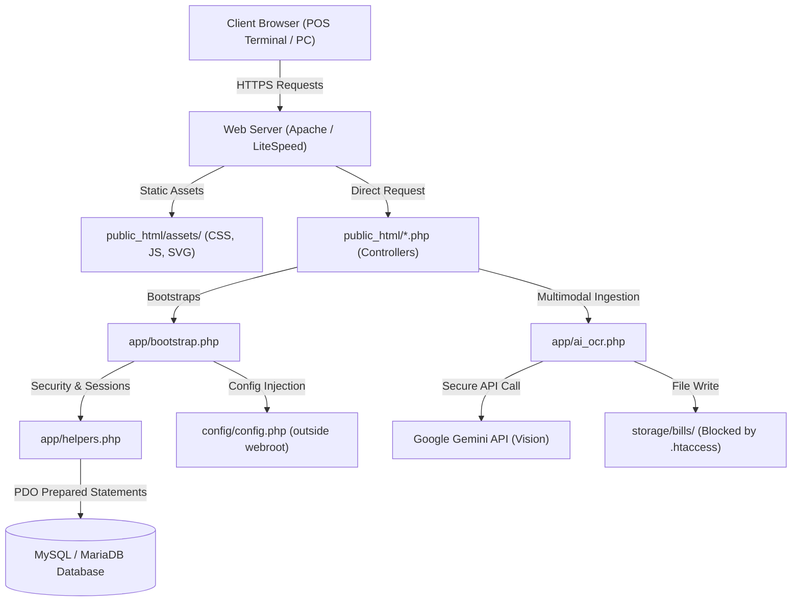

# System Architecture & Technical Specifications

## 1. Architectural Philosophy

Medical Store Management is built with a minimalist, zero-dependency architectural design. It avoids the maintenance overhead, security vulnerability surface, and performance penalties of heavy enterprise frameworks.

Key Tenets:
- **Zero Framework Bloat:** Pure PHP 8.1+ standard library.
- **Zero Asset Bundlers:** Native modern ES6+ and CSS3 directly delivered with caching headers.
- **Defense in Depth:** Parameterized queries, cryptographic tokens, strict Content Security Policy, and session isolation.
- **Portable Deployment:** Can be dropped into any shared hosting (Apache/LiteSpeed), VPS, or containerized LAMP stack.

---

## 2. Layered Component Architecture



---

## 3. Directory Layout Security Boundary

```
[OUTSIDE WEB ROOT - SECURE]
├── app/                  # Application business logic, templates, OCR routines
├── config/               # Database secrets, application keys (NEVER SERVED)
├── database/             # Schema definitions and migrations
├── storage/              # Uploaded supplier bill images/PDFs (Protected)
└── tests/                # Automated test suites

[INSIDE WEB ROOT - PUBLIC]
└── public_html/          # Only directory exposed to HTTP requests
    ├── assets/           # Client-side scripts and styles
    └── *.php             # Front controllers with auth guards
```

---

## 4. Key Workflows

### First-Expiry-First-Out (FEFO) Billing
1. Counter staff searches by trade name or active chemical salt.
2. The database aggregates batches with available inventory (`qty_available > 0`) ordered by `expiry_date ASC`.
3. If an item belongs to Schedule H, H1, or X, the frontend requires input of the prescribing Doctor's Name.
4. On save, a database transaction is opened:
   - Batch quantity is deducted.
   - Sale and line item records are written.
   - If paid by Credit, the customer's balance is incremented.
   - Transaction commits.
