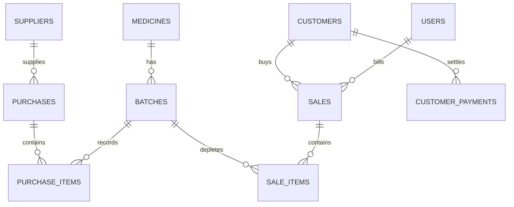

# Database Schema Documentation

The system utilizes a relational MySQL 8.0+ / MariaDB 10.6+ database with UTF8mb4 character encoding. All financial columns utilize `DECIMAL(10,2)` or `DECIMAL(12,2)` to prevent floating-point rounding errors.

## Entity-Relationship Overview

## Key Tables

| Table | Description | Critical Constraints |
|---|---|---|
| `users` | Store operators & owners | `role ENUM('admin', 'staff')`, `password_hash` |
| `medicines` | Master drug directory | `schedule ENUM('OTC', 'H', 'H1', 'X')`, unique trade names |
| `batches` | Physical inventory batches | `expiry_date`, `mrp`, `purchase_rate`, `qty_available` |
| `suppliers` | Distributors & stockists | `gstin`, `dl_no`, `balance` |
| `purchases` | Inward distributor invoices | `invoice_no`, `supplier_id`, `bill_file` |
| `sales` | Retail patient bills | `bill_no`, `customer_id`, `total`, `payment_mode` |
| `sale_items` | Individual medicines sold | `sale_id`, `medicine_id`, `batch_id`, `qty`, `tax` |
| `customers` | Patient & credit ledger | `phone`, `doctor_name`, `credit_limit`, `balance` |
| `shortage_book`| Out-of-stock medicine log | `medicine_name`, `customer_phone`, `status` |
| `settings` | Key-value store configuration| Store name, GSTIN, Drug License numbers, margins |
